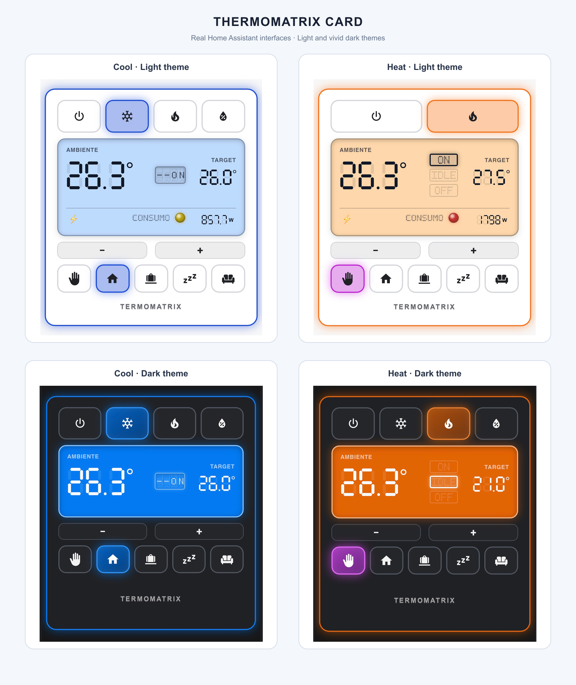

<div align="center">

[](#project-status)
[](https://www.home-assistant.io/)
[](https://www.hacs.xyz/)
[](https://github.com/issu-lab/thermomatrix-card/blob/main/LICENSE)

**An LCD-inspired climate card for Home Assistant.**

ThermoMatrix provides a clear climate control interface with seven-segment temperatures, automatic HVAC controls, presets and optional power monitoring.

</div>

---

## Project Status

| Field | Current state |
|---|---|
| **Maturity** | 🟢 Stable |
| **Used in my homelab** | ✅ Yes |
| **Recommended for production** | ✅ Yes |
| **Setup difficulty** | 🟢 Beginner |
| **Documentation** | ✅ Complete |
| **Current version** | `1.2.0` |

> [!NOTE]
> **Beginner setup:** installation is handled by HACS. After adding the custom repository, select a climate entity in the visual card editor.

> [!NOTE]
> Version 1.2.0 introduces a compact supplemental status and power row, translated advanced states and selectable display fonts.

---

## Why It Exists

ThermoMatrix was created for my own Home Assistant dashboards. I wanted a climate card that was compact, easy to read and visually different from standard controls.

The card is built for daily use first, then shared so other Home Assistant users can install and adapt it.

---

## Features

- 🌡️ Seven-segment room and target temperatures.
- 🔄 HVAC buttons generated automatically from the entity's `hvac_modes`.
- 🎛️ Automatic preset controls that can be disabled.
- 🟢 LCD-style `ON`, `IDLE` and `OFF` indicators.
- 🎞️ Optional mechanical wheel status display.
- ⚡ Optional power monitoring integrated directly into the main LCD, with a dedicated status LED.
- 📋 Optional extended status from a separate entity.
- 🎨 Dynamic or neutral borders.
- 🌓 Automatic light and vivid state-aware dark theme support.
- 🌍 Automatic Home Assistant language detection.
- 🖱️ Visual configuration editor.
- ♿ Accessible labels, tooltips and reduced-motion support.

---

## Interface

The gallery below shows the current card in real Home Assistant dashboards with light and dark themes.



---

## Installation with HACS

ThermoMatrix is installed as a HACS custom repository. Manual copying of the JavaScript file is not required.

<div align="center">

[](https://my.home-assistant.io/redirect/hacs_repository/?owner=issu-lab&repository=thermomatrix-card&category=plugin)

</div>

The button opens ThermoMatrix Card directly as a custom dashboard repository in HACS. Alternatively, add it manually:

1. Open **HACS** in Home Assistant.
2. Open the menu in the top-right corner.
3. Select **Custom repositories**.
4. Add this repository URL:

```text
https://github.com/issu-lab/thermomatrix-card
```

5. Select **Dashboard** as the repository type. Depending on the interface language or HACS version, it may appear as **Plancia** or use the older name **Plugin**.
6. Select **Add**.
7. Search for **ThermoMatrix Card** in HACS.
8. Open it and select **Download**.
9. Refresh the Home Assistant browser page after installation.

HACS manages the dashboard resource automatically.

> [!TIP]
> The general procedure is also described in the [HACS custom repository documentation](https://www.hacs.xyz/docs/faq/custom_repositories/).

---

## Add the Card

1. Open a Home Assistant dashboard.
2. Enter dashboard edit mode.
3. Select **Add card**.
4. Search for **ThermoMatrix Card**.
5. Select the climate entity and configure the available options in the visual editor.

A minimal YAML configuration is also available:

```yaml
type: custom:thermomatrix-card
entity: climate.living_room
```

---

## Configuration Example

```yaml
type: custom:thermomatrix-card
entity: climate.living_room
show_presets: true
show_consumption: false
show_climate_status: true
show_advanced_status: true
border_mode: state
temperature_step: 0.1
language: auto
hvac_button_labels: auto
preset_button_labels: auto
status_display: indicators
display_font: lcd
```

### Main options

| Option | Purpose |
|---|---|
| `entity` | Climate entity controlled by the card. |
| `show_presets` | Shows presets reported by the climate entity. |
| `show_consumption` | Enables the optional power module. |
| `power_entity` | Sensor used by the power module. |
| `status_entity` | Optional entity used for translated extended operating states. |
| `show_climate_status` | Shows the standard `ON`, `IDLE` or `OFF` status. |
| `show_advanced_status` | Shows the full-width advanced status line when `status_entity` is configured. |
| `border_mode` | Uses a state-based or neutral border. |
| `temperature_step` | Temperature adjustment step. |
| `language` | Uses automatic or manually selected translations. |
| `hvac_button_labels` | Controls HVAC button text visibility. |
| `preset_button_labels` | Controls preset button text visibility. |
| `status_display` | Selects the mechanical wheel or LCD indicators. |
| `display_font` | Selects the original LCD, condensed or monospace display style. |

---

## Responsive Button Labels

HVAC and preset labels can be configured independently:

```yaml
hvac_button_labels: auto
preset_button_labels: auto
```

Available values:

- `auto` — shows the icon and text when they fit, otherwise keeps only the icon.
- `show` — always shows both icon and text.
- `hide` — shows only the icon.

The complete name remains available as a tooltip and accessible label.

---

## Status Display

The default `indicators` display keeps the three compact `ON`, `IDLE` and `OFF` boxes. The active `ON` or `IDLE` label blinks as before.

The mechanical alphabet wheel remains available as an optional legacy style:

```yaml
status_display: wheel
```

Available values are `wheel` and `indicators`.

The standard climate status and the optional advanced status can be shown independently or together:

```yaml
type: custom:thermomatrix-card
entity: climate.living_room
status_entity: sensor.climate_status
show_climate_status: true
show_advanced_status: true
```

Set either selector to `false` to hide that part of the display. When both are enabled, the three essential status boxes remain between the temperatures while the translated advanced state appears in the compact lower row. Its animation runs only when the value changes and is disabled when reduced motion is requested.

The advanced state is translated when it matches common controller values such as `online`, `initializing`, `starting`, `idle`, `cooling`, `heating`, `drying`, `off` or `error`. Unknown values remain available through a humanized fallback.

### Display font

Values can use one of three display styles:

```yaml
display_font: lcd
```

- `lcd` — original seven-segment temperatures and power values.
- `condensed` — compact proportional values.
- `mono` — technical monospaced values.

### Recommended companion: ThermoPilot

[ThermoPilot](https://github.com/issu-lab/thermopilot) is a native Home Assistant climate controller designed to work especially well with ThermoMatrix. ThermoMatrix automatically follows the HVAC modes and presets exposed by ThermoPilot and can display its optional power-feedback or advanced status sensor through `status_entity`.

ThermoPilot is optional: ThermoMatrix remains compatible with any Home Assistant `climate` entity.

---

## Power Monitoring

Enable the optional consumption module with a compatible power sensor:

```yaml
type: custom:thermomatrix-card
entity: climate.living_room
show_consumption: true
power_entity: sensor.climate_power
border_mode: state
```

Power shares the compact lower row with the advanced status. It is hidden automatically when the configured sensor does not exist, and the whole lower row disappears when neither optional module is available.

---

## Languages

The default value is:

```yaml
language: auto
```

ThermoMatrix follows the Home Assistant profile language and falls back to English when the selected language is unavailable.

Included translations:

- English
- Italian
- Spanish
- French
- German
- Portuguese

A language can also be selected manually:

```yaml
language: it
```

Supported values are `auto`, `en`, `it`, `es`, `fr`, `de` and `pt`.

---

## Development

```shell
npm install
npm run build
```

The Home Assistant and HACS distributable is generated at:

```text
dist/thermomatrix-card.js
```

---

## Known Limitations

- Additional customization options may be introduced in future releases.
- Installation currently requires adding the repository manually to HACS.
- Compatibility has not yet been documented across multiple Home Assistant versions.
- The visual result depends on the features exposed by the selected climate entity.

---

## License

Released under the [MIT License](https://github.com/issu-lab/thermomatrix-card/blob/main/LICENSE).

---

<div align="center">

This project is part of the **iSSU Open Homelab ecosystem**.

<a href="https://github.com/issu-lab/Open-Homelab">
  
</a>

</div>
